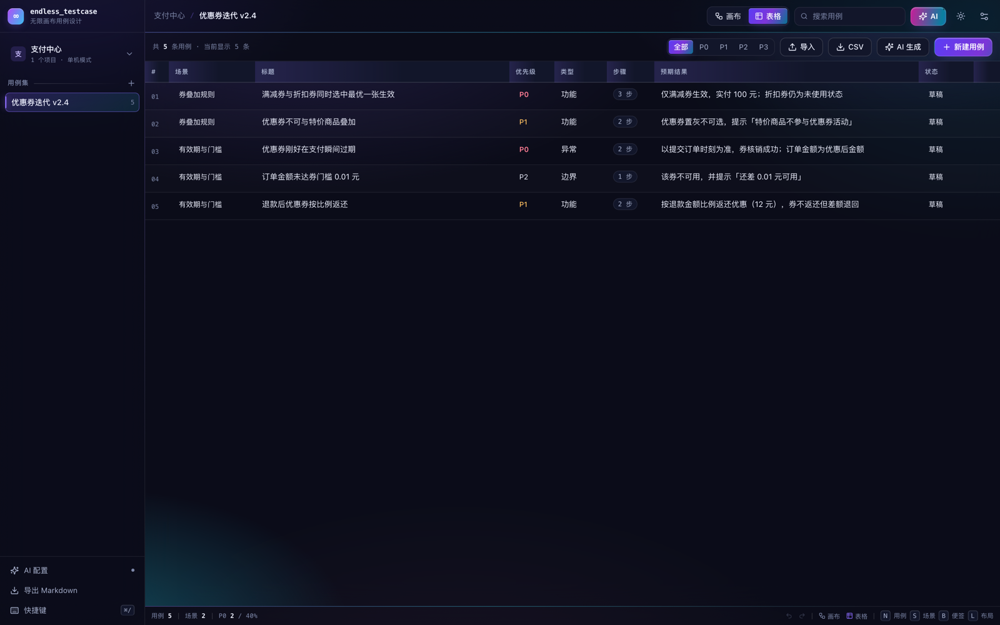
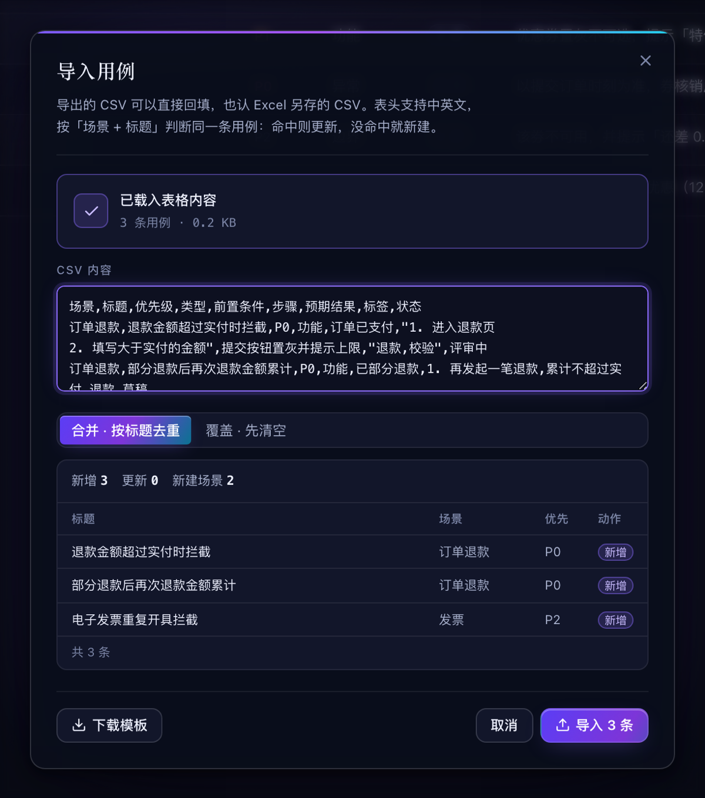

# endless_testcase

> 用无限画布「想」用例，用结构化表格「管」用例。

单机运行的测试用例编写平台：画布负责发散与推演，表格负责规范与交付，两者共用同一份数据。AI 只提议，人工确认后才落库。


## 功能介绍

- **画布**：无限画布，需求 / 场景 / 用例 / 便签四类节点，连线表达依赖，一键自动布局，支持小地图与多选
- **表格**：行内编辑、优先级筛选、全文搜索、批量新建与删除
- **双视图同源**：画布与表格读写同一份数据、共用同一个撤销栈，一侧修改另一侧即时同步
- **导入导出**：CSV 导入先试算再落库、按「场景 + 标题」去重；可导出 CSV 与 Markdown
- **AI 辅助**：需求转用例、场景发散补漏、步骤规范化，流式输出，结果以虚线幽灵节点铺在画布上，勾选后采纳
- **界面**：深色 / 浅色双主题，全局快捷键

| 表格 · 行内编辑 | 导入 CSV · 先试算再落库 |
|---|---|
|  |  |

## 架构设计

前端不持有业务真相，所有状态从服务端一次拉全量，之后由 store 做乐观更新；服务端无构建步骤，`node server/index.mjs` 即起。

| 层 | 选型 |
|---|---|
| 前端 | React 18 + TypeScript + Vite 6 |
| 画布 | @xyflow/react 12（自定义节点 / 边 / 小地图） |
| 状态 | Zustand（单一 store + 快照式撤销栈） |
| 布局 | @dagrejs/dagre |
| 后端 | Fastify 5（ESM，无需构建） |
| 存储 | JSON 文件 `data/db.json`（原子写入，250ms 防抖） |
| AI | DeepSeek（OpenAI 兼容协议），SSE 转发 |

数据模型：

```
Project ──1:N── Suite ──1:N── Case
                   │
                   └──1:1── Canvas(nodes, edges, viewport)
```

- `Case` 存全部业务字段（标题、优先级、步骤、预期等）
- `Case.groupId` 指向画布上的场景节点，分组关系只此一处
- `Canvas.nodes` 只存坐标与展示态，用例标题从 `cases` 读，因此两个视图永远一致

```
server/
  index.mjs       路由 + SSE + 导入导出
  db.mjs          存储、初始化与示例数据
  ai.mjs          密钥加解密、prompt、流式调用
src/
  components/     CanvasView / TableView / Inspector / AiDrawer / ImportModal …
  store.ts        单一数据源、跨视图同步、撤销、自动布局
  api.ts          REST + SSE 客户端
  styles.css      设计令牌 + 全部样式（双主题）
scripts/
  smoke.mjs       API 冒烟测试
  mock-ai.mjs     本地模拟 DeepSeek，便于无 Key 调试
```

## 使用方式

需要 Node.js 20.11 或以上，无需数据库。

```bash
npm install
npm run dev          # 前端 http://localhost:5173，API http://127.0.0.1:8787
```

生产模式：

```bash
npm run build        # 类型检查 + 打包到 dist/
npm start            # API 同时托管 dist，访问 http://127.0.0.1:8787
```

首次启动会生成示例项目「支付中心 / 优惠券迭代 v2.4」，可直接上手。

**配置 AI**：左侧「AI 配置」填入 DeepSeek API Key（`https://api.deepseek.com`，模型 `deepseek-chat`）→「保存并测试」。Key 加密存于本机，只回传配置状态。不配置也能使用全部画布与表格功能。

**导入 CSV**：表头支持中英文，最少需要「标题」一列，场景、优先级、步骤、预期等列存在即可识别。用 Excel 编辑请另存为 CSV UTF-8。

**数据**：全部在 `data/db.json`，复制即备份。

快捷键：

| 键 | 行为 |
|---|---|
| `N` / `S` / `R` / `B` | 新建用例 / 场景 / 需求 / 便签 |
| `Tab` | 为选中节点新建子节点并连线 |
| 双击空白 | 就地新建用例 |
| `L` | 自动布局 |
| `⌘K` | 唤起 AI 助手 |
| `⌘Z` / `⇧⌘Z` | 撤销 / 重做（跨视图） |
| `Delete` | 删除选中节点 |
| `⌘/` | 快捷键面板 |

## License

[MIT](LICENSE) © 2026 lxing01x
