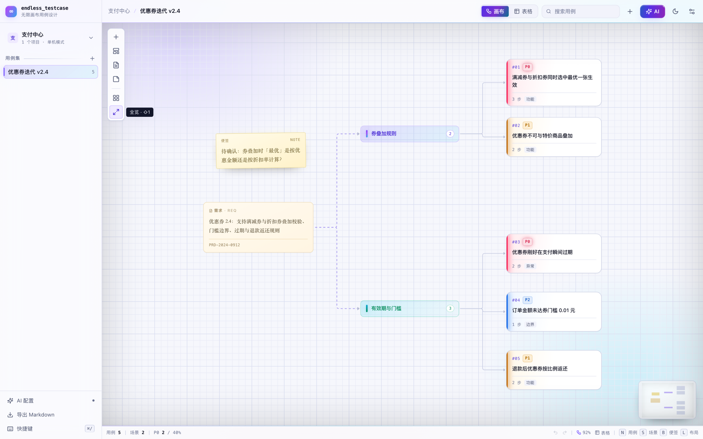
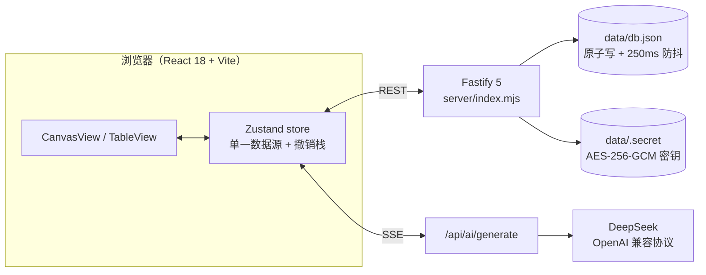

# endless_testcase

> 用无限画布「想」用例，用结构化表格「管」用例。

一个单机运行的测试用例编写平台：画布负责发散与推演，表格负责规范与交付，两者共用同一份数据。AI（DeepSeek）作为画布上的协作画师，产出以「虚线幽灵节点」的形式出现，确认后才落库。


## 功能介绍

### 画布：发散与推演

- 无限画布 + 节点编排，另留便签自由区，随手记下没想清楚的点
- 四类节点：**需求 / 场景 / 用例 / 便签**；双击空白处就地新建用例，`Tab` 为选中节点挂子节点并自动连线
- 连线表达依赖关系，`L` 一键 dagre 分层布局，把缠绕的节点理成场景流
- 小地图、缩放、框选、多选拖动；视口位置随用例集保存，下次打开还在原处
- 1000+ 节点可用：分层渲染 + 视口裁剪，只画看得见的部分

### 表格：规范与交付

- 行内编辑标题、优先级、类型、场景归属、预期结果、状态，改完即存
- 按优先级筛选、全文搜索（标题 / 标签 / 预期），批量新建与批量删除
- 用例的步骤、前置条件、标签在右侧检查器里改，与表格字段同源

### 双视图同源

画布和表格不是两份数据，是同一份用例的两种读法。

- 画布拖动 = 改布局；表格改标题 = 画布节点标题同步变化
- 两个视图共用一个撤销栈，`⌘Z` 在任何视图都有效，一次拖动就是一步
- 删除场景不会删用例，只解除分组，避免误删

### 导入与导出

- **CSV 导入**：拖文件、选择文件或直接粘贴，先 `dryRun` 试算再落库
- 默认按「场景 + 标题」去重，命中即更新；也可选择覆盖导入，覆盖前有明确警告
- 表头识别中英文，引号、换行、BOM 都能正确解析；未知场景会自动建节点并连线
- 导出 CSV（带 BOM，Excel 直接打开）与 Markdown（按场景分章节），可直接进评审文档

### AI 辅助（仅 DeepSeek）

- 三种能力：**需求转用例**、**场景发散补漏**、**步骤规范化**
- SSE 流式输出，结果先以虚线幽灵节点铺在画布右侧，逐条勾选后 `adopt` 才写库
- 一次采纳作为整体可撤销；未配置 Key 时给出明确引导，不阻塞其他功能
- Key 用 AES-256-GCM 加密存于本机，只回传 `configured` 状态，永不下发浏览器

### 界面与交互

- **深空实验室**深色主题为默认：近黑深空底 + 缓慢漂移的极光 + 玻璃浮层 + 霓虹节点；右上角一键切到浅色「雾光」，选择记在 `localStorage`
- 发光只标状态：选中节点呼吸光环，P0 粉红 / P1 琥珀 / P2 蓝 的色晕直接映射优先级
- 全局快捷键 + `⌘/` 快捷键面板，常用操作不用离开键盘

| 表格 · 行内编辑 | 导入 CSV · 先试算再落库 |
|---|---|
|  |  |

浅色「雾光」主题：



## 架构设计

### 总览



前端不持有业务真相，所有状态从服务端一次拉全量（项目 → 用例集 → 用例 + 画布），之后由 store 做乐观更新，失败回滚。服务端无构建步骤，`node server/index.mjs` 即起。

### 技术栈

| 层 | 选型 |
|---|---|
| 前端 | React 18 + TypeScript + Vite 6 |
| 画布 | @xyflow/react 12（自定义节点 / 边 / 小地图） |
| 状态 | Zustand（单一 store + 快照式撤销栈） |
| 布局 | @dagrejs/dagre |
| 后端 | Fastify 5（ESM，无需构建） |
| 存储 | JSON 文件 `data/db.json`（原子写入，250ms 防抖） |
| AI | DeepSeek（OpenAI 兼容协议），SSE 转发 |

### 数据模型

```
Project ──1:N── Suite ──1:N── Case
                   │
                   └──1:1── Canvas(nodes, edges, viewport)
```

- `Case` 存全部业务字段：标题、优先级、类型、前置条件、步骤数组、预期、标签、状态
- `Case.groupId` 指向画布上的**场景节点 id**，分组关系只有这一处真相，不冗余存场景名
- `Canvas.nodes` 只存坐标与展示态（需求原文、便签内容、场景名称），用例节点的标题从 `cases` 读
- 因此「表格改标题」只需改 `cases`，画布节点自动跟着变；「画布拖动」只改 `nodes`，不触碰用例

### 双视图同源怎么实现

1. store 里 `cases` 与 `canvas` 并列，节点渲染时按 `node.data.caseId` 取用例
2. 任何写操作前调 `pushHistory()` 拍一份快照（cases + nodes + edges），撤销即回放快照
3. 画布拖动结束、表格输入失焦都会走同一套 `updateCase` / `applyNodeChanges`，不存在两套更新路径
4. 撤销跨视图生效，是因为快照包含两个视图的全部状态，而不是各管各的历史

### AI 流水线

```
需求/场景 → prompt 组装 → DeepSeek 流式 → 逐行 JSON 解析
        → pending（幽灵节点，不落库） → 人工勾选 → adopt → 写 cases
```

- 生成结果不直接写库是硬约束：AI 只提议，人做决定
- 幽灵节点不在 `canvas.nodes` 里，拿不到 React Flow 的测量回调，因此显式给 `width/height/measured`
- 采纳复用普通建用例接口，所以 AI 产出和手工写的用例没有任何结构差异，后续可同等编辑、导出

### 目录结构

```
server/
  index.mjs       路由 + SSE + CSV 导入导出
  db.mjs          存储、初始化与示例数据
  ai.mjs          密钥加解密、prompt、流式调用、JSON 解析
src/
  components/     CanvasView / TableView / Inspector / AiDrawer / ImportModal / Sidebar …
  store.ts        单一数据源、跨视图同步、撤销、自动布局
  api.ts          REST + SSE 客户端
  styles.css      设计令牌 + 全部样式（双主题）
scripts/
  smoke.mjs       API 冒烟测试（node scripts/smoke.mjs，18 项）
  mock-ai.mjs     本地模拟 DeepSeek，便于无 Key 调试 AI 流程
docs/设计方案.md   产品与架构设计文档
```

### 几个踩过的坑（改代码前先看）

- **React Flow 12 受控节点必须回写 `dimensions`**：`type: 'dimensions'` 的变更要同步到 `measured/width/height`，否则节点 `visibility: hidden`，边也不渲染
- **Fastify v5 做 SSE 不要 `reply.hijack()`**：会挂住不返回，用 `Readable.from(asyncGenerator)` + `reply.send(stream)`
- **DELETE 无 body 时不要带 `Content-Type: application/json`**：Fastify 会因空 JSON 报 400
- **实心按钮用 `--grad-fill` 而非装饰用的 `--grad`**：后者尾部亮青配白字对比度只有 1.7:1

## 使用方式

### 环境要求

Node.js 20.11 或以上（服务端用到 `import.meta.dirname`），无需数据库。

### 本地运行

```bash
git clone git@github.com:lxing01x/endless_testcase.git
cd endless_testcase
npm install
npm run dev          # 前端 http://localhost:5173，API http://127.0.0.1:8787
```

首次启动自动生成示例项目「支付中心 / 优惠券迭代 v2.4」（5 条用例、2 个场景、1 段需求、1 张便签），可直接上手。

### 生产模式

```bash
npm run build        # 类型检查 + 打包到 dist/
npm start            # API 同时托管 dist，访问 http://127.0.0.1:8787
```

单端口、无外网依赖，适合放在自己机器上长期用。

### 配置 AI

左侧「AI 配置」→ 填 DeepSeek API Key（`https://api.deepseek.com`，模型 `deepseek-chat`）→「保存并测试」。

Key 加密后存在 `data/.secret` 与 `data/db.json` 中，**只留在本机**。不配置也能用全部画布与表格功能，AI 是增强而非依赖。

### 导入 CSV 的格式

表头支持中英文，列顺序不敏感，最少需要「标题」一列：

| 场景 | 标题 | 优先级 | 类型 | 前置条件 | 步骤 | 预期结果 | 标签 | 状态 |
|---|---|---|---|---|---|---|---|---|
| 下单 | 优惠券叠加使用 | P0 | 功能 | 已登录且有可用券 | 1. 选择商品　2. 使用两张券支付 | 按最优组合抵扣 | 优惠券,支付 | 通过 |

- 步骤用换行或 `1. 2. 3.` 编号分隔，导入时拆成步骤数组
- 优先级取 `P0/P1/P2`，类型、状态不认识的值会落到默认值，不会导致整行失败
- 用 Excel 编辑请「另存为 → CSV UTF-8」，避免中文乱码

### 快捷键

| 键 | 行为 |
|---|---|
| `N` / `S` / `R` / `B` | 新建用例 / 场景 / 需求 / 便签 |
| `Tab` | 为选中节点新建子节点并连线 |
| 双击空白 | 就地新建用例 |
| `L` | 自动布局（场景流） |
| `⌘K` | 唤起 AI 助手 |
| `⌘↵` | 在 AI 面板中触发生成 |
| `⌘Z` / `⇧⌘Z` | 撤销 / 重做（跨视图） |
| `Delete` | 删除选中节点 |
| `⌘/` | 快捷键面板 |
| `Esc` | 关闭面板 / 取消选中 |

### 数据与备份

全部数据在 `data/db.json`，**复制这个文件就是备份**；删掉后重启会重新生成示例数据。
`data/.secret` 是本机加密密钥，丢失后已保存的 API Key 无法解密，重新填写即可。

## 后续开发计划

### 已完成

- [x] 项目 / 用例集管理，示例数据自动初始化
- [x] 无限画布：四类节点、连线、自动布局、小地图、视口持久化
- [x] 表格视图：行内编辑、筛选、搜索、批量操作
- [x] 双视图同源 + 跨视图统一撤销栈
- [x] CSV 导入（试算 / 去重 / 覆盖）与 CSV、Markdown 导出
- [x] DeepSeek 三种 AI 能力，幽灵节点人工采纳
- [x] 深色 / 浅色双主题、快捷键面板、API 冒烟测试

### 下一步（按优先级）

1. **表格直接编辑步骤与前置条件** — 让「改用例」不必再开右侧面板，步骤支持增删行
2. **统计与追溯矩阵** — 需求 → 场景 → 用例的覆盖率视图，用例数 / 优先级分布 / 状态分布
3. **xlsx 导入导出 + 整库备份** — 摆脱「另存为 CSV」，支持导出/导入整个项目 JSON
4. **搜索定位到画布** — 表格命中后画布自动居中高亮对应节点
5. **用例模板与公共步骤** — 常用步骤组复用，减少重复填写

### 更远

- 模块化目录树（当前只有「用例集 → 场景」两级）
- 用例版本快照与变更对比、评审评论
- 标签字典与标签筛选、字段映射式导入
- 多模型抽象层（OpenAI / Claude / 本地 Ollama），prompt 模板可编辑
- 用例执行与结果回填、缺陷联动（超出「只写不跑」的当前定位）
- 多人协同需要引入 CRDT，单机版暂不做

### 已知边界

- 单机单用户，无鉴权与多租户
- 只写用例，不执行用例
- 导入仅支持 CSV，`.xlsx` / XMind 需先转换
- AI 仅适配 DeepSeek

更完整的取舍与权衡见 [`docs/设计方案.md`](docs/设计方案.md)。

## License

本项目采用 **个人非商业许可（Personal Non-Commercial License v1.0）**：

- ✅ 个人学习、研究、个人项目可免费使用、修改、分发
- ❌ 禁止任何商业用途，包括企业内部业务系统部署；商用需事先获得书面授权
- 📌 引用、转载或二次开发时须标注来源：项目名 `endless_testcase` 与仓库地址，并保留许可文件

完整条款见 [LICENSE](LICENSE)。Copyright © 2026 lxing01x.
